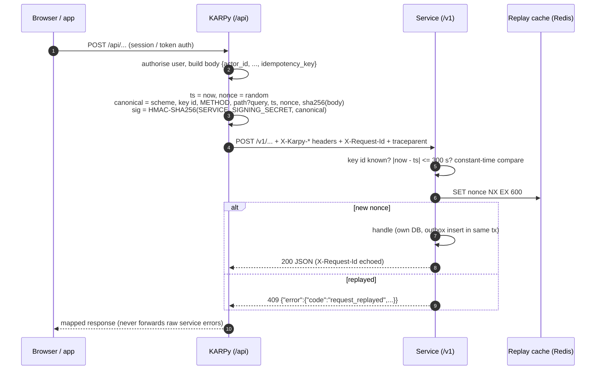

# Services architecture

KARPy (`backend/`, FastAPI + SQLAlchemy, API under `/api`) is the core of the platform:
users, roles and permissions, content, settings, media and the admin. Most features are
**KARPy plugins**. Some capabilities are better run as **separate services** written in
whatever language suits them — Go, Python, Node, Mojo... — and plugged in through one
language-neutral contract. This pattern (a Python core calling a signed Go service over
HTTP, with events over RabbitMQ) is already proven in the owner's earlier platform; this
repo keeps the pattern and drops everything product-specific.

The contract itself — signing, events, health, telemetry, errors, and per-language
examples — is in [`services/README.md`](../services/README.md).

## Plugin or service?

Write a **KARPy plugin** when the feature:

- is mostly CRUD on KARPy's own data, admin screens, or content;
- needs KARPy's permissions, hooks, menus, settings or translations directly;
- has ordinary load and no special runtime needs.

Write a **separate service** when at least one of these is true:

- it needs a different runtime or language (CPU-heavy compute, concurrency, a library
  only available in Go/Node/Mojo);
- it must scale, deploy or fail independently of the CMS (a queue worker, a gateway to a
  third party, a real-time component);
- it owns sensitive data or money that should sit behind a narrow API and its own
  database/credentials;
- a separate team owns it on its own release cycle.

If in doubt, start as a plugin. Extracting later is cheap when the plugin already talks
through an interface and emits events.

Rules either way: a service **owns its own database** (never reads KARPy's tables, and
KARPy never reads its tables); KARPy stays the source of truth for identity and
permissions and passes the minimum it needs (`actor_id`, scope) in the signed body;
services never call the public internet on KARPy's behalf without their own
allow-list.

## Contract summary

| Concern | Rule | Details |
| --- | --- | --- |
| API | OpenAPI 3.1 in `services/contracts/<service>.openapi.yaml`; `/v1` paths | [example](../services/contracts/example.openapi.yaml) |
| Auth | `KARPY-HMAC-SHA256-V1`: `X-Karpy-Key-Id`, `X-Karpy-Timestamp`, `X-Karpy-Nonce`, `X-Karpy-Signature: v1=<hex>`; 300 s skew; nonce replay cache; key ids for rotation; optional mTLS | [signing.md](../services/contracts/signing.md) |
| Events | RabbitMQ topic exchange `karpy.events`; routing key `<domain>.<entity>.<event>`; JSON envelope; outbox producer; inbox consumer; retry + DLQ | [envelope schema](../services/contracts/event-envelope.schema.json) |
| Health | `/healthz` liveness, `/readyz` readiness (dependencies, draining) | |
| Telemetry | OpenTelemetry over OTLP; W3C `traceparent`; JSON logs with `trace_id` | |
| Errors | `{"error":{"code","message","request_id"}}` | |

## A signed call



KARPy treats a service like any upstream: bounded timeout
(`SERVICE_REQUEST_TIMEOUT_SECONDS`), retries only for idempotent requests or requests
carrying an `idempotency_key`, and maps service error codes to its own responses.

## Event flow with the outbox

```mermaid
sequenceDiagram
    autonumber
    participant H as Producer handler
    participant DB as Producer DB
    participant O as Outbox relay
    participant X as RabbitMQ karpy.events (topic)
    participant Q as Consumer queue
    participant C as Consumer
    participant CDB as Consumer DB
    H->>DB: BEGIN; change state; INSERT event_outbox(envelope); COMMIT
    loop every ~500 ms
        O->>DB: claim pending rows (FOR UPDATE SKIP LOCKED)
        O->>X: publish (routing key = type, persistent, mandatory, confirms)
        X-->>O: ack
        O->>DB: mark published (nack/timeout -> back off, after N -> dead + alert)
    end
    X->>Q: route by binding (e.g. content.post.*)
    Q->>C: deliver (prefetch bounded)
    C->>CDB: BEGIN; INSERT event_inbox(consumer, idempotency_key) ON CONFLICT DO NOTHING
    alt first time
        C->>CDB: apply side effect; COMMIT
    else duplicate
        C->>CDB: ROLLBACK (already applied)
    end
    C-->>Q: ack
    Note over Q,C: transient error -> <queue>.retry (TTL) -> back to queue;<br/>after max attempts or unknown type/version -> <queue>.dead
```

KARPy uses the same pattern in the other direction: plugins write envelopes to KARPy's
own outbox and a relay publishes them using `RABBITMQ_URL` / `RABBITMQ_EXCHANGE`.

## Local development

The root `docker-compose.yml` provides the shared infrastructure on default ports:

| Service | Port(s) | Used by |
| --- | --- | --- |
| Postgres | 5432 | KARPy, and each service's own database (separate DB/user per service) |
| Redis | 6379 | KARPy cache/sessions, service nonce replay caches |
| RabbitMQ | 5672 (AMQP), 15672 (management UI), 15692 (Prometheus) | events |

Optional **`observability` profile** (defined in the root [`docker-compose.yml`](../docker-compose.yml)):

| Service | Port | Config |
| --- | --- | --- |
| OpenTelemetry Collector | 4317 (OTLP gRPC), 4318 (OTLP HTTP) | [`otel-collector.yaml`](../services/observability/otel-collector.yaml) |
| Jaeger (traces UI) | 16686 | receives OTLP from the collector |
| Prometheus | 9090 | [`prometheus.yml`](../services/observability/prometheus.yml) scrapes the collector and RabbitMQ |

```sh
docker compose up -d                                   # postgres, redis, rabbitmq
docker compose --profile observability up -d           # + collector, jaeger, prometheus
export OTEL_EXPORTER_OTLP_ENDPOINT=http://localhost:4317
```

Running the example service next to KARPy:

```sh
cd services/go-template
export KARPY_SERVICE_KEYS="local-1:$(openssl rand -hex 32)"
go run ./cmd/server                                    # :8080
# backend .env: SERVICE_KEY_ID=local-1, SERVICE_SIGNING_SECRET=<same secret>,
#               EXAMPLE_SERVICE_URL=http://localhost:8080
```

In compose, give each service its own block with `KARPY_SERVICE_KEYS`, `RABBITMQ_URL`,
`OTEL_EXPORTER_OTLP_ENDPOINT=http://otel-collector:4317` and `OTEL_SERVICE_NAME`, a
healthcheck on `/healthz`, and `depends_on` the infrastructure it needs.

## Checklist: adding a service

1. **Decide** plugin vs service with the criteria above; write down what the service owns
   (data, decisions) and what it must never do.
2. **Contract first**: `services/contracts/<name>.openapi.yaml` (copy the example: ops
   routes, signing security schemes, error schema), plus the event types it publishes and
   consumes with their `data` schemas and versions.
3. **Scaffold**: copy `services/go-template` (or follow the Python/Node/Mojo sections of
   `services/README.md`) into `services/<name>/`.
4. **Signing**: pass `services/contracts/signing-vectors.json`; `401` without detail on
   failure; `409` on replay; Redis replay cache if more than one replica.
5. **Keys**: generate a secret per caller→service pair (`openssl rand -hex 32`); add it to
   the service's `KARPY_SERVICE_KEYS` and to the caller's `SERVICE_KEY_ID` /
   `SERVICE_SIGNING_SECRET`; document rotation. Never commit secrets — `.env.example`
   holds names only.
6. **Health**: `/healthz` with no dependency checks; `/readyz` checks each hard dependency
   and fails while draining.
7. **Data**: own database and migrations; outbox table if it publishes, inbox table if it
   consumes.
8. **Events**: routing keys `<domain>.<entity>.<event>`; envelope validated against the
   schema; queues `<service>.<purpose>` with retry queue and DLQ; consumers idempotent.
9. **Telemetry**: OTLP export, `traceparent` in/out (HTTP and AMQP headers), JSON logs with
   `trace_id` and `request_id`, request/outbox/consumer metrics.
10. **Errors and versioning**: error shape everywhere, stable codes, `/v1` additive-only.
11. **KARPy side**: a base-URL setting (`<NAME>_SERVICE_URL`), a thin client built on
    `services/python-client` (to live in `backend/karpy_platform/integrations/services/`),
    mapped errors, timeouts, and a plugin that exposes the feature in KARPy.
12. **Ship**: Dockerfile (multi-stage, non-root, distroless or slim), compose entry,
    healthchecks, CI running the service's tests and the signing vectors.
